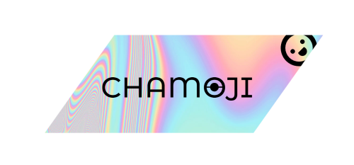

# Chamoji brand

The look for every chamoji surface: the editor extension (milestone 10), the desktop app (milestone 12), the Cloud pages (milestones 13–15), the readme and the terminal. It comes from the original chamoji logo (`chamoji-logo.png`, from [HeavenlyEntity/chamoji](https://github.com/HeavenlyEntity/chamoji)).



Two previews:

- **`pnpm brand:preview`:** the live Iridescence foil, the logo plate and Marow Block.
- **[`holo-preview.html`](holo-preview.html):** the CSS-only foil and swatches, which is the fallback.

## The chromatic effect

The logo is a **holographic foil plate**:

- **Shape:** a parallelogram slanted **35°**. In CSS that's `transform: skewX(-35deg)`, with the content inside counter-skewed so it stays upright.
- **Surface:** a pastel iridescent sweep from sage and mint through periwinkle and sky to orchid, pink and peach.
- **Rings:** thin-film interference rings (an "oil-slick" pattern) on the left third, fading out toward the centre.
- **Wordmark and mark:** near-black, sitting on top of the foil. The foil is never placed behind light text.

### Colours

Extracted from the logo's pixels, ordered as they appear left to right.

| Token               | Hex       | Role                                          |
| ------------------- | --------- | --------------------------------------------- |
| `--holo-sage`       | `#d5e1cb` | Foil stop                                     |
| `--holo-mint`       | `#afeee5` | Foil stop                                     |
| `--holo-periwinkle` | `#bbbff2` | Foil stop                                     |
| `--holo-sky`        | `#a8e2f6` | Foil stop (the largest area in the logo, 22%) |
| `--holo-orchid`     | `#dfade5` | Foil stop                                     |
| `--holo-pink`       | `#faadc3` | Foil stop                                     |
| `--holo-peach`      | `#fbcfb3` | Foil stop                                     |
| `--ink`             | `#070708` | Wordmark, mark, and any text on foil          |

**Foil gradient:**

```css
--holo: linear-gradient(
	115deg,
	var(--holo-sage),
	var(--holo-mint),
	var(--holo-periwinkle),
	var(--holo-sky),
	var(--holo-orchid),
	var(--holo-pink),
	var(--holo-peach),
	var(--holo-sage)
);
```

Use `background-size: 160% 100%`, and animate `background-position` slowly (about 9 s, alternating) for a sheen. Turn the animation off under `prefers-reduced-motion`. The rings are a `repeating-radial-gradient` of the same stops in roughly 5 px bands, masked to the left. See `holo-preview.html` for the exact CSS.

**Neutral surfaces** carry everything that isn't foil:

| Token         | Light     | Dark      |
| ------------- | --------- | --------- |
| `--surface`   | `#ffffff` | `#0b0b0f` |
| `--surface-2` | `#f4f4f6` | `#16161d` |
| `--text`      | `#070708` | `#f5f5f7` |
| `--muted`     | `#5b5b66` | `#a3a3b2` |

### The foil in apps: Iridescence

GUI surfaces (the desktop app, Cloud pages and the website) render the foil live with **Iridescence**, a WebGL2 shader component from [React Bits](https://reactbits.dev). It's tuned to the logo's pastels.

- **Files:**
  - [`components/Iridescence.tsx`](components/Iridescence.tsx): the component, unchanged apart from a license header.
  - [`components/ChamojiFoil.tsx`](components/ChamojiFoil.tsx): `CHAMOJI_FOIL` (our props), `<ChamojiFoil>` (a foil surface with content on top) and `<ChamojiPlate>` (the 35° logo plate with the Marow Block wordmark).
- **Our tuning:**

  | Prop         | Value     |
  | ------------ | --------- |
  | `color`      | `#fff1ea` |
  | `hueShift`   | -12       |
  | `saturation` | 0.9       |
  | `brightness` | 1.12      |
  | `contrast`   | 0.9       |
  | `speed`      | 0.35      |
  | `scale`      | 1.25      |
  | `stir`       | 0.4       |
  | `sheen`      | 0.3       |
  | `grain`      | 0.04      |

  Keep `brightness` near 1.1. Higher values clip the folds to white, and the plate loses its edge against a white page.

- **Fallback:** `<ChamojiFoil>` paints the CSS `--holo` gradient underneath the canvas. Where WebGL2 is unavailable, or before the first frame, the surface still shows the foil colours. The component already holds still under `prefers-reduced-motion`.
- **Where to use it:**
  - the logo plate
  - hero and onboarding backgrounds
  - the active-workstream badge (with `stir={0}`, `clickSwirl={false}` and `sheen={0}`)
  - celebratory moments, such as shipping a workstream
- **Where not to use it:**
  - behind dense UI or text blocks
  - for more than one animated foil in view at once; each one is a WebGL canvas
  - in small controls, where the CSS gradient is cheaper and looks the same
- **Styling:** the component uses six Tailwind classes. Apps without Tailwind add them as plain CSS; see `preview/index.html`.
- **License:** React Bits is MIT + Commons Clause. We may use the component inside chamoji's own apps, including paid ones. We may not sell or redistribute the component itself, so never export it from a published package like `@chamoji/core` or `@chamoji/cli`. Keep it inside app code.
- **Preview:** run `pnpm brand:preview`, then open `http://localhost:4173`. It shows the plate, a full-bleed foil, light and dark UI samples, and the display type. Marow Block appears only if the font files are in `docs/brand/fonts/`.

### Rules

- **Foil is an accent, not a background.** Use it for the logo plate, primary buttons, focus rings, active-workstream borders, progress bars and empty-state art. Body text and dense UI sit on neutral surfaces.
- **Text on foil is always `--ink`.** The stops are all light, so ink passes contrast on every one of them. Never put foil-coloured text on white.
- **In dark mode the foil stays as it is.** It reads as light on dark, so keep ink text on it. Borders made of foil, drawn as a masked 1.5 px gradient, work well on dark surfaces.
- **Motion is slow and optional.** The sheen is decoration, so nothing important should depend on it.

## Typography

**Display: Marow Block** (Regular, v1.000, by Ramandhani). The chamoji face for the wordmark, page titles, hero lines and empty states.

- **Style:** heavy, rounded and retro, with very wide letters. Upper and lower case share one design, so `chamoji` and `CHAMOJI` set the same.
- **Character set:** 111 glyphs, with limited punctuation. Display only: never body text, labels, numbers in tables or anything people read at length.
- **Licensing:** the license covers embedding the font in our app and website (confirmed 2026-10-28). The raw font files still aren't in git, because this repo is public and publishing them would redistribute the font. See [`fonts/README.md`](fonts/README.md) for where the files live locally and how to ship the font inside an app.
- **CSS:**

  ```css
  @font-face {
  	font-family: 'Marow Block';
  	src: url('/fonts/MarowBlock-Regular.ttf') format('truetype');
  	font-display: swap;
  }
  --font-display: 'Marow Block', system-ui, sans-serif;
  ```

**Interface: Tansa Bold** (v1.000, by Panca Hasan / Drizy Font). The face for UI elements: buttons, tabs, navigation, badges, labels, section headings, card titles and short UI lines.

- **Style:** a clean, bold grotesque with full Latin, including accented letters, so names like "Café" and "Ñandú" render properly.
- **Weight:** only Bold (700) is here. Declare it with `font-weight: 700` so browsers don't fake a bold on top of it.
- **Licensing:** the license covers embedding the font in our app and website (confirmed 2026-10-28). The font files stay local only, like Marow Block's (see [`fonts/README.md`](fonts/README.md)).
- **CSS:**

  ```css
  @font-face {
  	font-family: 'Tansa';
  	src: url('/fonts/Tansa-Bold.ttf') format('truetype');
  	font-weight: 700;
  	font-display: swap;
  }
  --font-ui: 'Tansa', system-ui, -apple-system, 'Segoe UI', sans-serif;
  ```

**Headline: Know** (Regular, v1.002, by Perfectype / Setyo Wati). A clean sans for the headlines people must read at a glance: the hero line and the closing call to action. It's set like the display face (capitals, a hairline stroke under the fill), only in Know.

- **Weight:** only Regular (400) is here. Declare `font-weight: 400`.
- **Licensing:** the license covers embedding the font in our app and website (confirmed 2026-10-27). The files stay local only, like the other faces' (see [`fonts/README.md`](fonts/README.md)).

  ```css
  @font-face {
  	font-family: 'Know';
  	src: url('/fonts/Know-Regular.ttf') format('truetype');
  	font-weight: 400;
  	font-display: swap;
  }
  --font-headline: 'Know', system-ui, sans-serif;
  ```

**Body copy:** descriptions, help text, commit bodies and anything longer than a line use `--font-body` (`system-ui`, -apple-system, 'Segoe UI', sans-serif). It stays there until Tansa's Regular or Medium weights are added; Bold is too heavy for paragraphs.

**Code and terminal output:** a monospace face.

| Role                                    | Token             | Face             |
| --------------------------------------- | ----------------- | ---------------- |
| Wordmark, titles, empty states          | `--font-display`  | Marow Block      |
| Hero and closing headlines              | `--font-headline` | Know             |
| Buttons, tabs, labels, headings, badges | `--font-ui`       | Tansa Bold       |
| Paragraphs and help text                | `--font-body`     | System sans      |
| Code, hashes, terminal                  | `--font-mono`     | System monospace |

**The original wordmark** (the thin, wide caps in `chamoji-logo.png`) is retired. Marow Block replaces it everywhere.

## Motion and interaction

**Animation library: GSAP** (with `@gsap/react`'s `useGSAP` in React). It's for the website and Cloud pages, where the job is storytelling:

- scroll-scrubbed scenes and pinned sections with **ScrollTrigger**
- headlines that build in with **SplitText**
- sequenced timelines, such as commits gathering into a workstream, then into a release ticket

**License:** GSAP is free for commercial use, plugins included, under its [standard license](https://gsap.com/standard-license). The one restriction is building no-code visual animation tools that compete with Webflow, which chamoji is not.

**Motion** (MIT, `motion` on npm) is the alternative for in-app React UI: layout transitions, gestures and presence in the desktop app and extension. Don't use both on the same surface.

**The waitlist design** uses CSS only, because the design canvas can't run a library:

- **Ambient:** floating tickets and coins, drifting foil, rising sparkles.
- **On interaction:**
  - foil buttons that lift, shimmer and glow, and press in on click
  - cards that rise, with their icon tile wiggling
  - nav links that grow a foil underline
  - a foil focus ring
  - a FAQ "+" that turns into "×"
  - copy-to-clipboard feedback
  - a foil burst when the waitlist form is submitted
- **On scroll:** sections fade up, in browsers with CSS scroll-driven animations.

**Rules:**

- Motion supports the copy; it never carries meaning by itself.
- Ambient loops are slow (5–22 s).
- Interactions take 150–700 ms.
- Everything turns off under `prefers-reduced-motion`.

## Icons

**Source:** [Phosphor](https://phosphoricons.com) **duotone** icons, taken from [Iconify](https://icon-sets.iconify.design/ph/) (`ph:<name>-duotone`). Phosphor is MIT-licensed, so the SVGs can live in the public repo and need no credit on the page. The licensed "computer programming" pack used earlier is retired.

**Styling:** each icon is inlined as SVG, never loaded as an image or icon font.

- The outline layer is ink (`#070708`).
- The duotone layer (Phosphor's 20%-opacity shape) is filled at full opacity with the foil gradient: sage → mint → periwinkle → sky → orchid → pink → peach, running top-left to bottom-right (`<linearGradient id="holo">`, defined once per page).
- The result reads as ink drawn over foil, like the logo.

**Use them sparingly:** only next to copy they illustrate, at 18–42 px, on a light tile (`#f6f5fb`) so the ink outlines also read on dark surfaces. On the waitlist page:

| Copy                        | Icon (`ph:…-duotone`)                                                  |
| --------------------------- | ---------------------------------------------------------------------- |
| Commit stage, commits FAQ   | `git-commit`                                                           |
| CHANGELOG stage             | `scroll`                                                               |
| CLI card, CLI plan, CLI FAQ | `terminal-window`                                                      |
| Cloud page card             | `cloud`                                                                |
| Hosted release notes        | `globe`                                                                |
| Context insurance           | `brain`                                                                |
| Review packets              | `git-pull-request`                                                     |
| Team plan                   | `users-three`                                                          |
| Organization plan           | `buildings`                                                            |
| FAQ                         | `shield-check` (code), `sparkle` (AI), `calendar-check` (early access) |

## React Bits

**The agentframe template** (React Bits Pro, commercial license) is the model for how the website tells its story.

- **Patterns borrowed for chamoji,** in chamoji's brand:
  - its run walkthrough: stage cards joined by connectors, a dot travelling between stages, the active stage lighting up, numbered tabs that take over from the auto-loop, and a pause when the walkthrough is offscreen or the viewer prefers reduced motion
  - fade-up reveals as you scroll
  - copy-feedback buttons
- **On the waitlist page,** this is the "Commits in. Context out." section: 01 Commit as usual → 02 Chamoji sorts → 03 Release ships.
- **License limit:** the license allows use and modification in our own commercial projects. It forbids redistributing the source. So code copied from agentframe may go into **private** repositories only, such as the waitlist and Cloud site, and **never into this public repo**.

**Iridescence** is already in use (see above).

**More React Bits components** can be installed in the Vercel build with the React Bits key kept in `.env.local`. Never commit the key.

**The same license rule applies to all of them:** use components inside our apps, and never re-export them from a published package.

## Terminal

The CLI shows the same palette where the terminal supports it:

- **Banner and headings:** a truecolor gradient across the foil stops, with `ink-gradient` / `gradient-string` given the custom stops above. The old chamoji used `ink-gradient`'s `retro` preset, which is a warmer sunset palette and doesn't match the logo.
- **Fallbacks:** 256 colours, then plain text. Colour is turned off for `NO_COLOR`, non-terminal output and `--format json`.

## Assets

| File                         | What it is                                                                                                                                                                                                     |
| ---------------------------- | -------------------------------------------------------------------------------------------------------------------------------------------------------------------------------------------------------------- |
| `chamoji-plate.png`          | The official logo: the foil plate with the Marow Block wordmark, 994 × 324 px, transparent. Regenerate with `scripts/render-logo.py` (a numpy port of the Iridescence shader with the `CHAMOJI_FOIL` settings) |
| `chamoji-logo.png`           | The original logo, 500 × 233 px, kept for reference. The wordmark is now set in Marow Block                                                                                                                    |
| `fonts/`                     | Marow Block, Tansa Bold and Know, local only (git-ignored); see `fonts/README.md`                                                                                                                              |
| `components/Iridescence.tsx` | The React Bits foil shader                                                                                                                                                                                     |
| `components/ChamojiFoil.tsx` | Chamoji's tuning, the foil surface and the logo plate                                                                                                                                                          |
| `preview/`                   | Sources for `pnpm brand:preview`                                                                                                                                                                               |
| `holo-preview.html`          | The CSS-only foil, swatches and samples (the fallback)                                                                                                                                                         |

**Still needed** before milestone 10:

- an SVG version of `chamoji-plate.png`, with the wordmark outlined as paths
- the mark on its own
- app icons at 16–1024 px
- a favicon
- a social preview image (1280 × 640)
